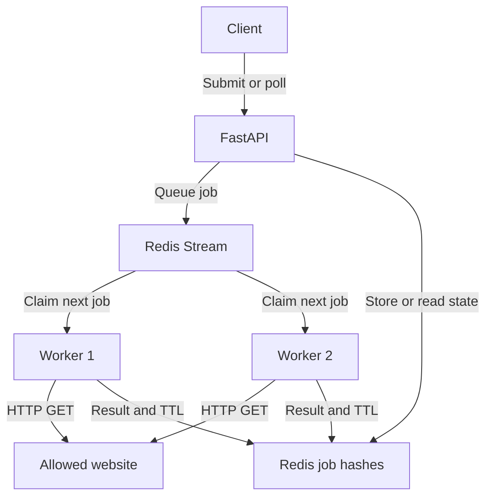

# Let's Check

A distributed website health checker built with Python, FastAPI, Redis Streams,
and independent worker processes. Submit an approved URL, receive a job ID,
and poll for the HTTP outcome, latency, attempts, and worker that handled it.

The API waits for Redis to queue the job, then returns HTTP 202. Separate
workers perform the network requests, so a slow website does not keep the
submission request waiting for the check to finish. Two workers share a Redis
consumer group and each handle one job at a time.

**Live verification on Windows, 2026-10-20:** a 20-site batch and two
200-site batches completed with both workers participating. The baseline
200-site run completed in **50.95 seconds**. A subsequent browser-style
User-Agent run also completed all 200 jobs; both runs classified 150
results as healthy under the project's HTTP-status rules.

Previously recorded automated test result: **58 passed, 1 warning**.
See the [original demo evidence](docs/DEMO_EVIDENCE.md) and
[multi-website results and instructions](docs/BATCH_RESULTS.md).
This project is a local portfolio MVP.

## Architecture



The API writes a queued job hash and a stream entry before returning 202.
Workers read with `XREADGROUP`, save the running state, perform a streamed HTTP
GET, and store the completed result with a 24-hour expiry. They acknowledge the
stream message with `XACK` only after that final write succeeds. Poll requests
read the stored job hash; they do not trigger another website request.

Redis Streams provides a shared backlog, consumer groups, and pending-message
tracking without a separate task framework. Docker Compose runs Redis; the API
and workers run as independent Python processes on the same computer.

## First setup on Windows

Requirements: Python 3.11 or later, Docker Desktop with Compose, and a terminal.
VS Code is convenient; Git is needed for version control and GitHub publication.
The verified Windows setup uses Python 3.11.7 and the `redis:7.4-alpine` image.

Extract the source or clone your repository. In VS Code, open the project folder
that directly contains `requirements.txt` and `docker-compose.yml`. Open
**Terminal > New Terminal**, using PowerShell. Keep Docker Desktop running.
Run these commands one at a time:

```powershell
py -3.11 -m venv .venv
.\.venv\Scripts\python.exe -m pip install -r requirements.txt
.\.venv\Scripts\python.exe -m pip check
.\.venv\Scripts\python.exe -m pytest -q
docker compose up -d redis
docker compose ps
docker compose exec redis redis-cli ping
```

Expect passing tests, Redis running, and `PONG`. Its healthcheck can take a few
seconds. If you already have the working environment, continue with the run
commands below. Every command uses the virtual environment's Python directly;
activation and PowerShell execution-policy changes are unnecessary.

Direct dependencies are pinned in `requirements.txt`. To record all packages
installed on a particular machine, optionally save `pip freeze` output to a
separate lock file for that environment.

## Run the API and two workers

Use four terminals, all opened in the project folder. Keep the API and worker
commands running. If a process is already running, use that instance.

**Terminal 1 — API:**

```powershell
.\.venv\Scripts\python.exe -m uvicorn app.main:app --reload
```

Wait for **Application startup complete**. The interactive API docs are at
[http://127.0.0.1:8000/docs](http://127.0.0.1:8000/docs), version **0.5.0**.
The bare `/` route is not defined, so its 404 response is expected.

**Terminal 2 — worker one:**

```powershell
$env:WORKER_ID = "worker-1"
.\.venv\Scripts\python.exe -m app.worker
```

**Terminal 3 — worker two:**

```powershell
$env:WORKER_ID = "worker-2"
.\.venv\Scripts\python.exe -m app.worker
```

Wait for **Worker worker-1 ready** and **Worker worker-2 ready**.

**Terminal 4 — submit and poll:**

```powershell
$job = Invoke-RestMethod -Method Post -Uri "http://127.0.0.1:8000/checks" -ContentType "application/json" -Body '{"url":"https://example.com"}'
$job
Invoke-RestMethod -Uri "http://127.0.0.1:8000/checks/$($job.job_id)"
```

POST returns 202 and the queued job ID. Repeat the last command until its
status is `completed`. You can also use **Try it out** on `/docs`; copy the
actual POST response's `job_id` into GET, rather than using a schema example.

To stop the Python processes, press **Ctrl+C** in each API/worker terminal.
`docker compose down` stops Redis while preserving its named data volume.

## API and result semantics

| Endpoint | Response |
| --- | --- |
| `POST /checks` | 202 with `job_id` and `status: queued`; 422 for invalid URLs; 503 if Redis cannot enqueue. |
| `GET /checks/{job_id}` | 200 with stored state; 404 for absent, invalid, or expired IDs; 503 if stored data cannot be read. |
| `/docs` | Interactive API documentation. |

Illustrative completed GET response. The ID, timestamps, and latency below are
examples, not measurements from the verified batch:

```json
{
  "job_id": "00000000-0000-4000-8000-000000000001",
  "url": "https://example.com/",
  "status": "completed",
  "http_status": 200,
  "reachable": true,
  "healthy": true,
  "latency_ms": 142,
  "attempts": 1,
  "worker_id": "worker-2",
  "error": null,
  "submitted_at": "2026-01-01T12:00:00Z",
  "started_at": "2026-01-01T12:00:01Z",
  "finished_at": "2026-01-01T12:00:01.142Z"
}
```

| State | Information available |
| --- | --- |
| `queued` | ID, URL, submission time; outcome fields are null. |
| `running` | Also worker ID and start time; unfinished outcomes remain null. |
| `completed` | HTTP/network outcome, elapsed check time, attempts, worker, and finish time. |

`completed` means processing finished, including an unsuccessful network check.
`reachable` means an HTTP response arrived. `healthy` means its status was
200–399; redirects are recorded without following them. HTTP 503 is reachable
but unhealthy and is not retried. Network failures have null `http_status`,
false reachability/health, and a sanitized error string.

HTTPX connection errors and timeout exceptions get one retry, for at most two
attempts. Other request errors and HTTP responses are terminal. A successful
retry has `attempts: 2` and `error: null`. Each request uses HTTPX's 5-second
operation timeout; it is not a single 5-second deadline for the whole job.
`latency_ms` measures total elapsed HTTP check time across attempts, excluding
queue waiting time. All timestamps use UTC.

Completed job hashes expire 24 hours after their final write. Queued/running
hashes have no expiry. Older records completed before TTL support was added
are not migrated. To inspect a completed job's remaining expiry:

```powershell
$jobId = $job.job_id
docker compose exec redis redis-cli TTL "letscheck:job:$jobId"
```

A fresh completed record should have a positive TTL near 86400 seconds.
`-1` means no expiry; `-2` means the key is absent. Expired jobs return 404.

## Configuration

Set environment variables in the API and both worker terminals before starting
their processes. Workers read the same URL policy as the API.

| Variable | Default | Purpose |
| --- | --- | --- |
| `REDIS_URL` | `redis://127.0.0.1:6379/0` | Redis address, matching Compose's published IPv4 port. |
| `ALLOWED_HOSTS` | `example.com,httpbin.org` | Comma-separated exact hostnames, case-insensitive. An empty list blocks all hosts. |
| `WORKER_ID` | Hostname plus process ID | Consumer identity; use `worker-1` and `worker-2` for the demo. |

Only HTTP(S) URLs are accepted. Embedded credentials, localhost names, nonpublic
IP literals, and non-allowlisted hosts are rejected. Redirects are never followed.
The stream is `letscheck:checks`, the group is `letscheck-workers`, and hashes
use `letscheck:job:<uuid>`. The group starts at `0-0` to include queued backlog.

## Tests and the 20-job demo

Automated tests use mocked Redis and HTTP, without Docker or public internet:

```powershell
.\.venv\Scripts\python.exe -m pytest -q
```

Observed Windows result: **58 passed, 1 warning in 1.14s**. Coverage includes URL
validation, Redis failures, job lookup, HTTP success/errors, bounded retries,
redirect handling, result expiry, and saving before acknowledgment. The one
warning is an upstream Starlette TestClient HTTPX deprecation; it does not fail
the suite. More detail is in [tests/README.md](tests/README.md).

With Redis, the API, and both named workers running, execute in terminal 4:

```powershell
.\.venv\Scripts\python.exe .\scripts\demo_20_jobs.py
```

The manual demo submits 20 independent checks of `https://example.com` and polls
for up to 180 seconds. PASS requires all 20 jobs completed and both expected
worker IDs present. Counts need not be equal. A failed website check still
counts as processed; its actual outcome appears in the report.

Each run saves a unique JSON report under `demo-results/`, including submitted
IDs, latest results, worker counts, timestamps, and pass/fail status. Reports
are excluded from Git. On failure or interruption, IDs already received and
results already collected are retained. The helper does not cancel accepted
jobs or retry POST requests. The verified Windows batch and its terminal
summary are recorded in [docs/DEMO_EVIDENCE.md](docs/DEMO_EVIDENCE.md).

## Tradeoffs and limitations

- Queuing adds Redis and a polling step, but lets the API hand network work to
  independent processes and gives workers a shared backlog.
- Consumer groups track pending messages. A worker crash before acknowledgment
  can leave a job pending indefinitely: automatic reclaim/recovery is not
  implemented. This MVP makes no exactly-once delivery guarantee.
- Redis transactions group job writes and stream publication, but do not roll
  back commands that encounter runtime errors. AOF persistence is enabled for
  the local Redis service; this is not a high-availability deployment.
- Completed hashes expire after 24 hours; stream entries and unfinished hashes
  are retained without trimming. Storage cleanup beyond result TTL is future work.
- This is a controlled local demo without authentication, scheduling, alerts,
  or a frontend. Its allowlist is not a complete DNS/SSRF defense for public
  deployment.
- Two named worker processes were demonstrated on one Windows computer. No
  multi-machine deployment, speedup, or throughput benchmark is claimed.

## Project files and GitHub

| Path | Purpose |
| --- | --- |
| `app/` | API, schemas, Redis queue/storage, and worker loop. |
| `tests/` | Deterministic API and worker tests. |
| `scripts/demo_20_jobs.py` | Original 20-job example.com demo. |
| `scripts/demo_20_sites.py` | Batch helper for 20 distinct allowed hosts. |
| `scripts/demo_200_sites.py` | Batch helper for 200 distinct allowed hosts. |
| `sites_20.txt`, `sites_200.txt` | Target lists for the multi-website demos. |
| `docs/BATCH_RESULTS.md` | Live results, reproduction instructions, and report links. |
| `docs/results/` | Selected JSON reports retained as evidence. |
| `docker-compose.yml` | Local Redis, AOF persistence, volume, and healthcheck. |
| `requirements.txt` | Pinned direct Python dependencies. |
| `docs/DEMO_EVIDENCE.md` | Recorded Windows test/batch evidence. |
| `docs/GITHUB_SETUP.md` | First commit and publication steps. |

Follow [the GitHub setup guide](docs/GITHUB_SETUP.md) to publish your copy.
Repository: [hitesh-na/Lets-Check](https://github.com/hitesh-na/Lets-Check).

## References

- [Python virtual environments](https://docs.python.org/3.11/library/venv.html)
- [Docker Compose services](https://docs.docker.com/reference/compose-file/services/)
- [Redis consumer groups](https://redis.io/docs/latest/commands/xgroup-create/)
- [Redis transactions](https://redis.io/docs/latest/develop/clients/redis-py/transpipe/)
- [HTTPX async streaming](https://www.python-httpx.org/async/)
- [HTTPX exception hierarchy](https://www.python-httpx.org/exceptions/)
- [FastAPI testing](https://fastapi.tiangolo.com/tutorial/testing/)
