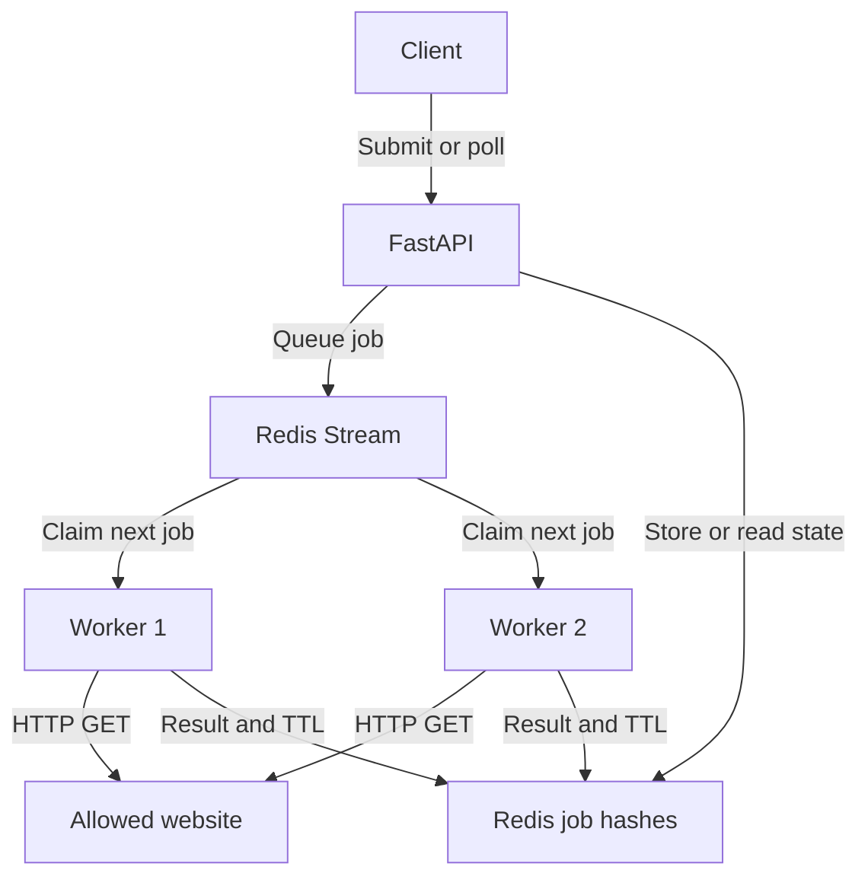

# Let's Check

Let's Check is a website health checker built with Python, FastAPI, Redis Streams, and HTTPX. Give it a list of websites, and it checks their HTTP responses, records how long each check takes, and saves the results in a report.

You choose which websites to check and how many to include. The general batch runner counts the entries automatically, so changing the size of your list doesn't require changing the Python code. The included 20-site and 200-site lists are examples you can try or replace with your own.

Checks run in the background through separate workers. The API puts jobs into a shared Redis queue, and available workers pick them up. While one worker waits for a slow website, another can keep working through the list.

**Live verification:** two batches of 200 different websites completed with both workers contributing. The baseline batch took **50.95 seconds**, including submission and polling. The results and saved reports are linked below.

## What it checks

For each URL, Let's Check records:

- The HTTP response status.
- Whether an HTTP response arrived.
- Whether the response meets the project's health rule.
- Time spent on the HTTP check, including any retry.
- Number of attempts.
- The worker that processed the job.
- A network error if the request failed.

This checks HTTP availability. It doesn't verify every feature on a website or measure how quickly a page loads in a browser.

## Architecture



When a client submits a URL, the API stores the job in Redis and returns HTTP 202 with a job ID. The website request happens separately, so the client doesn't have to wait for the website to respond before receiving that ID.

Workers share a Redis Streams consumer group. Each worker takes one job at a time, marks it as running, sends an HTTP GET request, and saves the completed result. Workers check the supplied URLs; they don't discover links or crawl entire websites.

A worker acknowledges its stream message with `XACK` only after saving the result. Completed results expire after 24 hours. Polling the API reads the stored result rather than making another request to the website.

Docker Compose runs Redis. The API and workers run as independent Python processes. The recorded demonstrations used two workers on one Windows computer.

## What we tested

On October 20, 2026, we checked 20 different websites, then compared two runs of the same 200-website list:

- One using the default request header.
- One using a browser-style User-Agent.

| Measurement | 20 websites | 200: default header | 200: browser header |
| --- | ---: | ---: | ---: |
| Completed checks | 20/20 | 200/200 | 200/200 |
| Healthy under the HTTP rule | 19 | 150 | 150 |
| HTTP 403 responses | 1 | 39 | 40 |
| No HTTP response | 0 | 7 | 6 |
| Jobs handled by worker-1 | 9 | 113 | 94 |
| Jobs handled by worker-2 | 11 | 87 | 106 |

The baseline 200-site batch finished in **50.95 seconds**, including submission and polling.

Both 200-site runs completed every job. In each run, 150 checks met the health rule and 50 did not. Completing a job means processing finished; its result can still be an HTTP error or a network failure.

Changing the User-Agent left the healthy count at 150. These runs did not show an improvement in the overall healthy count from that change.

The saved reports contain the individual website results:

- [Full comparison and batch notes](docs/BATCH_RESULTS.md)
- [Default-header report](docs/results/200-sites-default-header.json)
- [Browser-header report](docs/results/200-sites-browser-header.json)

These measurements describe local runs. Results and runtime will vary with the machine, network, and websites being checked. Batches larger than 200 have not been verified live in the recorded evidence.

## Getting started on Windows

You'll need:

- Python 3.11 or later.
- Docker Desktop with Docker Compose.
- PowerShell.
- Git if you want to clone the repository.

The recorded Windows setup used Python 3.11.7.

### 1. Install dependencies and start Redis

Clone the repository, or open your existing project folder:

```powershell
git clone https://github.com/hitesh-na/Lets-Check.git
cd Lets-Check
```

Keep Docker Desktop running, then create the Python environment and install dependencies:

```powershell
py -3.11 -m venv .venv
.\.venv\Scripts\python.exe -m pip install -r requirements.txt
```

Start Redis:

```powershell
docker compose up -d redis
docker compose exec redis redis-cli ping
```

Redis should respond with `PONG`. If it is still starting, wait a few seconds and run the ping again.

The commands below use the virtual environment's Python directly, so activating the environment is optional.


### 2. Choose your websites

Create a file named `sites.txt` in the project folder. Put one hostname on each line:

```text
example.com
www.python.org
github.com
```

Use hostnames without `https://`, paths, or port numbers. The batch runner requests the HTTPS root URL of each hostname.

Add or remove entries to choose the number of websites. You don't need to supply a separate count.

To try the included 200-site list:

```powershell
Copy-Item .\sites_200.txt .\sites.txt
```

For the 20-site example, use `sites_20.txt` instead.

### 3. Load the list and start the API and workers

Open four PowerShell terminals in the project folder.

If the API or workers are already running, stop them with Ctrl+C before loading a different list.

Run these commands in **all four terminals**:

```powershell
$sites = @(Get-Content .\sites.txt | ForEach-Object { $_.Trim().ToLowerInvariant() } | Where-Object { $_ -and -not $_.StartsWith('#') } | Sort-Object -Unique)
if ($sites.Count -eq 0) { throw "Add at least one website to sites.txt" }
$env:ALLOWED_HOSTS = $sites -join ','
```

This loads the same host list into each terminal. Blank lines and comments starting with `#` are ignored, and duplicate hostnames are checked once.

Environment variables are local to each terminal, which is why the list must be loaded in each one.

**Terminal 1: start the API**

```powershell
.\.venv\Scripts\python.exe -m uvicorn app.main:app --reload
```

Wait for `Application startup complete`.

Interactive API documentation is available at [http://127.0.0.1:8000/docs](http://127.0.0.1:8000/docs).

**Terminal 2: start worker one**

```powershell
$env:WORKER_ID = "worker-1"
.\.venv\Scripts\python.exe -m app.worker
```

**Terminal 3: start worker two**

```powershell
$env:WORKER_ID = "worker-2"
.\.venv\Scripts\python.exe -m app.worker
```

Wait for both workers to report that they are ready. Keep the API and both workers running.

### 4. Run your batch

In terminal 4:

```powershell
.\.venv\Scripts\python.exe .\scripts\check_sites.py --wait-seconds 1800 --output-dir .\demo-results\custom-sites
```

The runner submits one job per unique hostname, waits for completion, prints a summary, and saves a uniquely named JSON report.

The same command works with different list sizes, including a single website. To change the batch later:

1. Edit `sites.txt`.
2. Stop the API and workers.
3. Reload the list in all four terminals.
4. Restart the API and workers.
5. Run the batch command again.

There is no fixed 20-site or 200-site count in the general runner. Practical capacity depends on available memory, environment-variable size limits, worker count, network conditions, and the websites' response times.

`--wait-seconds` sets the polling time allowance after submission. The runner finishes earlier when all jobs finish. Increase the allowance for larger or slower batches.

For the general runner, **PASS means every requested job completed**. It doesn't require both workers to contribute, so a small batch can finish on one worker and still pass.

### 5. Read the report

The terminal prints the report's location. To display the newest custom report:

```powershell
$latest = Get-ChildItem .\demo-results\custom-sites\*.json | Sort-Object LastWriteTime -Descending | Select-Object -First 1
$report = Get-Content $latest.FullName -Raw | ConvertFrom-Json
$report.results | Select-Object url, http_status, healthy, latency_ms, attempts, worker_id | Format-Table -AutoSize
```

To display unsuccessful checks:

```powershell
$report.results |
    Where-Object { $_.healthy -ne $true } |
    Select-Object url, http_status, attempts, error |
    Format-Table -AutoSize -Wrap
```

Reload the report after each run so you're viewing the latest results.

Generated reports are saved locally and ignored by Git. Selected example reports are retained in `docs/results/`.

## Understanding the results

| Field or result | Meaning |
| --- | --- |
| `queued` | The job is waiting for a worker. |
| `running` | A worker has started processing it. |
| `completed` | Processing finished, including unsuccessful checks. |
| `reachable: true` | An HTTP response arrived. |
| `healthy: true` | The response status was between 200 and 399. |
| `latency_ms` | Time spent checking the URL across attempts, excluding queue time. |
| `attempts` | Number of HTTP attempts, up to two. |
| `worker_id` | Worker that handled the job. |

Redirects are recorded without following their destinations. A redirect therefore meets the current health rule, but its destination has not been checked.

An HTTP 403 response means access was denied. That response alone doesn't prove the website is down or identify why the request was blocked.

The current worker sends a browser-style User-Agent through HTTPX. It doesn't launch a browser or execute JavaScript.

Connection errors and timeouts get one retry, for a maximum of two attempts. Other request errors and HTTP status responses are not retried.

HTTPX uses a five-second operation timeout. This is not a single five-second deadline for the whole job.

Completed results expire from Redis after 24 hours. JSON reports already saved to disk remain available.

## Using the API directly

You can submit individual URLs without using a batch runner.

| Endpoint | Purpose |
| --- | --- |
| `POST /checks` | Submit a URL and receive HTTP 202 with a job ID. |
| `GET /checks/{job_id}` | Retrieve the job's current state and result. |
| `/docs` | Explore and try the API interactively. |

For example, with `example.com` allowed:

```powershell
$job = Invoke-RestMethod -Method Post -Uri "http://127.0.0.1:8000/checks" -ContentType "application/json" -Body '{"url":"https://example.com/"}'
$job
Invoke-RestMethod -Uri "http://127.0.0.1:8000/checks/$($job.job_id)"
```

Repeat the GET request until the job is completed.

The API also accepts HTTP URLs and specific page paths. The hostname must still be allowed.

Invalid URLs return 422. Missing, invalid, or expired job IDs return 404. Redis availability problems return 503.

## Configuration

Set environment variables before starting the API and workers.

| Variable | Default | Purpose |
| --- | --- | --- |
| `REDIS_URL` | `redis://127.0.0.1:6379/0` | Redis connection address. |
| `ALLOWED_HOSTS` | `example.com,httpbin.org` | Comma-separated exact hostnames that may be checked. |
| `WORKER_ID` | Hostname plus process ID | Worker identity recorded in results. |

Both the API and workers validate the hostname allowlist. URLs with embedded credentials, localhost names, and nonpublic IP literals are rejected.

Additional workers can join the same queue with unique worker IDs. Each worker processes one job at a time. The recorded live tests used two workers.

## Automated tests and original demos

Run the automated tests with:

```powershell
.\.venv\Scripts\python.exe -m pytest -q
```

The earlier recorded Windows result was **58 passed, 1 warning**. These tests use mocked Redis and HTTP, so Docker and public website access are not required.

Coverage includes URL validation, API responses, Redis failures, HTTP outcomes, retries, redirect handling, result expiry, and saving results before acknowledging jobs.

See [tests/README.md](tests/README.md) and [the original evidence](docs/DEMO_EVIDENCE.md) for details.

The original demonstration submits 20 checks of `example.com`:

```powershell
.\.venv\Scripts\python.exe .\scripts\demo_20_jobs.py
```

It requires all 20 jobs to complete and both named workers to contribute. Make sure `example.com` is allowed in the API and workers before running it.

The original `demo_20_sites.py` and `demo_200_sites.py` scripts retain their fixed expected counts and two-worker requirement. Use `check_sites.py` for your own list sizes.

## Current limitations

- The live demonstrations ran on one computer. Multi-machine deployment and performance at larger scales have not been verified.
- If a worker crashes after claiming a job, automatic recovery of that pending job is not implemented.
- Completed result hashes expire, but stream entries and unfinished jobs are not automatically cleaned up.
- Authentication, recurring schedules, alerts, and a web dashboard are not implemented.
- The hostname allowlist is not a complete DNS/SSRF defense for a public deployment.
- This is a local project, and Redis is not configured as a highly available service.

## Stopping the project

Press Ctrl+C in the API and worker terminals.

To stop Redis:

```powershell
docker compose down
```

The named Redis data volume is retained.

## Project layout

| Path | Purpose |
| --- | --- |
| `app/main.py` | FastAPI endpoints. |
| `app/schemas.py` | URL validation and response models. |
| `app/queue.py` | Redis queue and job storage. |
| `app/worker.py` | HTTP checks and worker loop. |
| `scripts/check_sites.py` | General batch runner, created in the setup instructions. |
| `scripts/demo_20_jobs.py` | Original 20-job example.com demo. |
| `scripts/demo_20_sites.py` | Original 20-site demo. |
| `scripts/demo_200_sites.py` | Original 200-site demo. |
| `sites_20.txt`, `sites_200.txt` | Example website lists. |
| `tests/` | Automated API and worker tests. |
| `docs/BATCH_RESULTS.md` | Live batch comparison and report links. |
| `docs/results/` | Selected JSON reports. |
| `docker-compose.yml` | Local Redis service and persistent volume. |
| `requirements.txt` | Python dependencies. |

Repository: [hitesh-na/Lets-Check](https://github.com/hitesh-na/Lets-Check).